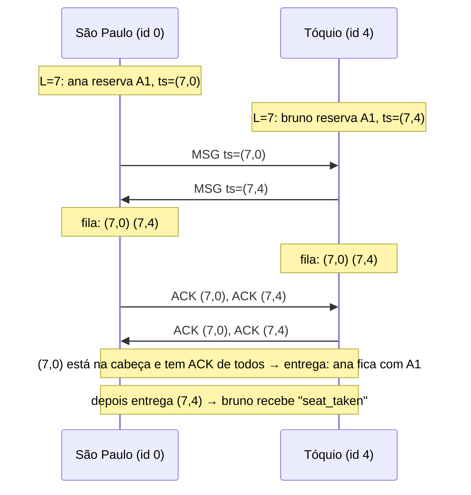
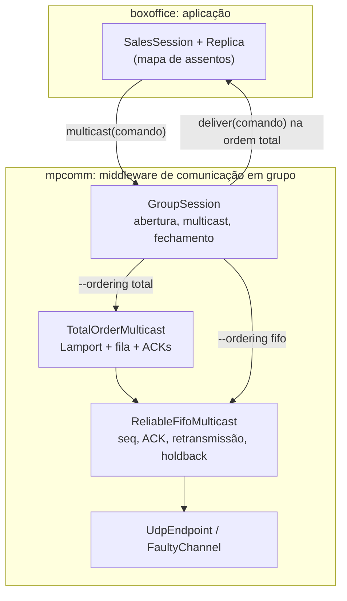
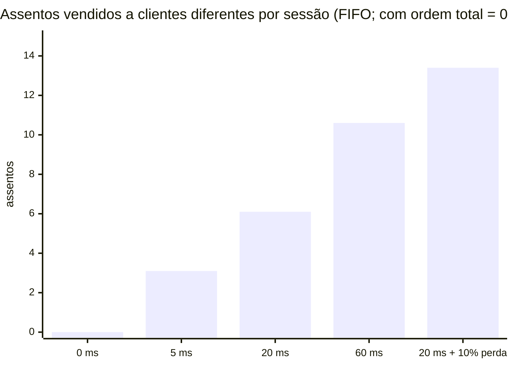
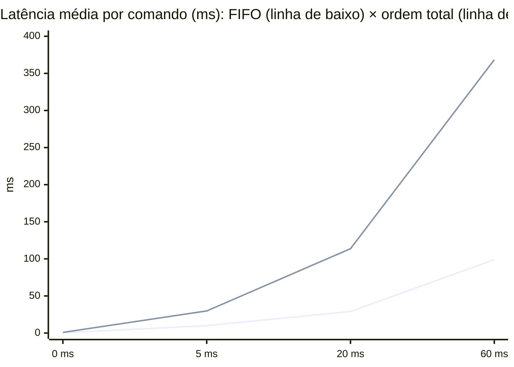

# Bilheterias replicadas com ordenação total (relógios de Lamport)

[](https://github.com/fernandes-emmanuel/trabalho-final-sd-pt-3/actions/workflows/ci.yml)

Parte 3 do trabalho final de Sistemas Distribuídos. Partindo da
[Parte 2](https://github.com/fernandes-emmanuel/trabalho-final-sd-pt-2), em que bilheterias
replicam um mapa de assentos por multicast confiável FIFO, esta parte projeta e implementa um
**mecanismo de coordenação baseado em ordenação total de mensagens**: o *multicast totalmente
ordenado com relógios de Lamport* (Tanenbaum & van Steen, Cap. 5). O README também verifica, com
experimentos, a eficácia do mecanismo para garantir a **consistência entre as réplicas**.

## Integrantes – Grupo K

- Emmanuel Fernandes Castro
- Monik Alves da Costa
- Luis Cesar Ferreira do Carmo

## Sumário

1. [O problema](#o-problema)
2. [O mecanismo: multicast totalmente ordenado](#o-mecanismo-multicast-totalmente-ordenado)
3. [Arquitetura](#arquitetura)
4. [Detalhes de implementação](#detalhes-de-implementação)
5. [Considerações sobre a garantia de consistência](#considerações-sobre-a-garantia-de-consistência)
6. [Evidências experimentais](#evidências-experimentais)
7. [Custo da ordenação total](#custo-da-ordenação-total)
8. [Como executar](#como-executar)
9. [Testes](#testes)
10. [Estrutura do repositório](#estrutura-do-repositório)
11. [Limitações](#limitações)

## O problema

Cada bilheteria mantém uma réplica do mapa de assentos e aplica os comandos (`reserve`,
`reserve_group`, `cancel`) na ordem em que os recebe. O mapa é uma máquina de estados
determinística, mas os comandos **não comutam**: se São Paulo aplicar "ana reserva A1" antes de
"bruno reserva A1" e Tóquio aplicar na ordem inversa, cada bilheteria vende o assento para uma
pessoa diferente.

Na Parte 2, com multicast confiável **FIFO**, todo comando chegava a toda réplica, mas comandos de
bilheterias diferentes chegavam em ordens diferentes. Com apenas 5 ms ± 5 ms de latência, **nenhuma**
sessão terminava com as réplicas consistentes.

A condição para resolver isso é clássica, da replicação de máquinas de estados: **todas as réplicas
devem aplicar os mesmos comandos na mesma ordem.** Isso é exatamente o que o multicast totalmente
ordenado garante.

## O mecanismo: multicast totalmente ordenado

O algoritmo é o da Seção 5.2 de *Distributed Systems* (Tanenbaum & van Steen), que usa **relógios
lógicos de Lamport**.

**Relógio de Lamport** (um por bilheteria):
- antes de enviar qualquer mensagem: `L ← L + 1`, e a mensagem leva o carimbo `L`;
- ao receber uma mensagem com carimbo `t`: `L ← max(L, t) + 1`.

**Algoritmo:**

1. Para enviar o comando `m`, a bilheteria `p` carimba `ts(m) = L` e o envia por multicast a
   **todo o grupo, inclusive a si mesma**.
2. Ao receber `m`, cada bilheteria:
   - insere `m` numa **fila de prioridade** ordenada por `(ts(m), id do remetente)`; o id desempata
     carimbos iguais e torna a ordem **total**;
   - envia por multicast um **ACK** de `m` a todo o grupo, também carimbado.
3. Uma bilheteria **entrega** (aplica) a mensagem que está na **cabeça da fila** quando recebeu o
   ACK dessa mensagem de **todos os membros do grupo**.

O algoritmo exige um canal **confiável e FIFO** entre cada par de processos. É exatamente o que a
Parte 1 construiu sobre UDP: números de sequência, ACKs de transporte, retransmissão e *holdback
queue*. A Parte 3, portanto, é uma camada a mais sobre a pilha que já existia.

### Exemplo: corrida pelo assento A1



Com FIFO, São Paulo aplicaria o comando da ana imediatamente e Tóquio aplicaria o do bruno
imediatamente: overbooking. Com ordem total, as duas bilheterias esperam a fila se estabilizar e
aplicam **na mesma ordem**, `(7,0)` antes de `(7,4)`. A ana fica com o assento em todas as réplicas,
e o bruno é informado de forma consistente.

## Arquitetura

A arquitetura em camadas da Parte 2 permitiu acrescentar a ordenação total **sem alterar o domínio
da aplicação**. O modo de ordenação é escolhido por sessão (`--ordering fifo|total`), o que também
permite comparar os dois mecanismos lado a lado.



| Camada | Módulo | Responsabilidade |
|---|---|---|
| Aplicação | `boxoffice/domain/`, `boxoffice/office/` | Máquina de estados determinística (mapa), réplica, serviços gRPC |
| Sessão de grupo | `mpcomm/group/session.py` | Ciclo de vida da sessão; escolhe a ordenação; fechamento coordenado |
| **Ordenação total** | `mpcomm/ordering/total_order.py` | **Relógio de Lamport, fila de prioridade, ACKs, regra de entrega** |
| Multicast confiável FIFO | `mpcomm/transport/reliable.py` | Garante as premissas do algoritmo: sem perda, sem duplicata, FIFO |
| Transporte | `mpcomm/transport/udp.py`, `faults.py` | Sockets UDP e injeção de falhas |

## Detalhes de implementação

### Mensagens da ordenação total

Viajam dentro das mensagens `DATA` do multicast confiável:

```json
{"order": "msg", "ts": 7, "body": {"id": "0.3", "op": "reserve", "seats": ["A1"], "customer": "ana"}}
{"order": "ack", "ts": 9, "ref": [7, 0]}
{"order": "end", "ts": 41}
```

O remetente vem do cabeçalho do transporte. O `ref` de um ACK identifica a mensagem confirmada
pelo par `(carimbo, remetente)`.

### Estruturas de dados

Em [`TotalOrderMulticast`](mpcomm/ordering/total_order.py):

| Estrutura | Uso |
|---|---|
| `LamportClock` | `tick()` antes de cada envio; `observe(t)` a cada recebimento |
| `_queue` (*heap*) de `Stamp(time, sender)` | Fila de prioridade das mensagens recebidas e ainda não entregues |
| `_acks: dict[Stamp, set[int]]` | Quem já confirmou cada mensagem. ACKs podem chegar **antes** da própria mensagem (vindos de um terceiro) e são guardados mesmo assim |
| `_release_deliverable()` | Enquanto a cabeça da fila tiver ACK de todos os membros, retira e entrega |

### Fechamento coordenado da sessão

Encerrar a venda exige cuidado, porque uma bilheteria precisa continuar mandando ACKs enquanto
houver comandos de outras em andamento. O fechamento acontece em duas fases:

1. A bilheteria para de aceitar pedidos e envia um **`end` totalmente ordenado**. Como ela não
   emite mais comandos depois dele, e o relógio de Lamport só cresce, todos os comandos dela têm
   carimbo menor que o seu `end`.
2. Quando os `end` de **todos** os membros foram entregues em ordem total, nenhum comando pode
   mais aparecer. Só então a sessão envia o `END` do transporte FIFO, espera os ACKs de transporte
   e manda o *snapshot* ao auditor.

### Concorrência

- **Ordem fixa de locks:** emissão → ordem total → envio → transporte. A thread de recepção nunca
  segura um lock ao repassar mensagens para a camada de cima. Para isso, o multicast confiável
  passou a entregar fora do seu lock interno, o que é seguro porque só uma thread de recepção
  entrega mensagens. Assim não existe ciclo de espera, e portanto não há *deadlock*.
- **Um único lock de emissão** cobre "verificar se a venda está aberta e carimbar e enviar o
  comando". Isso garante que nenhum comando seja emitido depois do `end` da própria bilheteria.

### Melhorias em relação à Parte 2

- **Pacotes que chegam antes da abertura da sessão.** As bilheterias abrem a sessão uma após a
  outra. Antes, um `HELLO` que chegava a uma bilheteria ainda não aberta era descartado e só voltava
  por retransmissão (≥ 200 ms), atrasando todo o fluxo FIFO daquele remetente. Agora esses pacotes
  ficam num buffer limitado e são reprocessados, na ordem, quando a sessão abre. Sem atraso de rede,
  o p95 da latência caiu de 115,7 ms para 1,4 ms.
- **Buffer de recepção UDP de 4 MB.** O padrão do Windows é de 64 KB, pequeno para as rajadas de
  N² ACKs da ordem total.
- **Métricas de custo** no relatório do auditor: latência por comando (média e p95), pacotes de rede
  por comando, mensagens e ACKs da ordem total e pico da fila.

## Considerações sobre a garantia de consistência

### O que é garantido

**Teorema.** Com canais confiáveis e FIFO, membros que não falham e um grupo fixo durante a
sessão, todas as bilheterias entregam **exatamente as mesmas mensagens, na mesma ordem**: a ordem
crescente de `(ts, remetente)`.

**Argumento:**

1. **Os carimbos são únicos e totalmente ordenados.** O par `(ts, remetente)` é único, porque cada
   processo incrementa o próprio relógio a cada envio. A comparação lexicográfica define uma ordem
   total.
2. **Nada pode ultrapassar a cabeça da fila depois da entrega.** Suponha que `p` entregue `m`, na
   cabeça da fila e com ACK de todos, e que depois chegue a `p` uma mensagem `m'` com
   `ts(m') < ts(m)`, enviada por `q`.
   - `q` enviou um ACK de `m`, com carimbo maior que `ts(m)`, porque o relógio de `q` passou por
     `max(L, ts(m)) + 1`.
   - O relógio de `q` só cresce, então `m'`, com carimbo menor, foi enviada **antes** desse ACK.
   - Como o canal de `q` para `p` é FIFO, `m'` chegou a `p` **antes** do ACK de `m`.
   - Então `m'` já estava na fila quando `m` foi entregue, e estaria à frente de `m`.
   - Isso contradiz `m` estar na cabeça. ∎
3. **Toda mensagem acaba entregue.** Com canais confiáveis e processos ativos, todo membro recebe
   toda mensagem e envia o ACK, e esse ACK chega a todos. A cabeça da fila sempre recebe todos os
   ACKs e sai da fila.

**Consequência para a aplicação (replicação de máquinas de estados):** o mapa de assentos é
determinístico, e o resultado de cada comando depende só do estado anterior. Então réplicas que
aplicam a mesma sequência de comandos:

- passam pelos **mesmos estados**, com o mesmo *digest* SHA-256;
- produzem o **mesmo resultado** para cada comando. O cliente recebe a mesma resposta que qualquer
  outra bilheteria daria: **um assento nunca é vendido a dois clientes**.

### Que tipo de consistência é essa

- As **escritas** (comandos) são aplicadas em ordem total, e cada bilheteria só responde ao
  cliente depois de aplicar o comando na sequência global. As réplicas executam o mesmo histórico.
- As **leituras** (`map`) são locais: uma bilheteria pode mostrar um mapa que ainda não inclui
  comandos já emitidos em outra. O sistema oferece **consistência sequencial**, não
  linearizabilidade. Para uma bilheteria, isso basta: a decisão que importa, quem fica com o
  assento, é tomada pela ordem total e é idêntica em todas as réplicas.

### Premissas e o que acontece quando elas falham

| Premissa | Garantida por | Se falhar |
|---|---|---|
| Canais sem perda nem duplicação | Multicast confiável da Parte 1 (ACK + retransmissão) | Comprovado nos experimentos com 10% de perda: consistência mantida |
| Canais FIFO | Números de sequência + *holdback queue* | Sem FIFO, a prova do item 2 não vale |
| Grupo fixo durante a sessão | Membros obtidos do group manager na abertura | Mudança de grupo exigiria um protocolo de *view change* |
| Membros não falham | Não garantido | **Segurança preservada, vivacidade perdida:** sem o ACK de um membro, a fila para de andar. Nenhuma réplica diverge, mas a venda fica bloqueada até o fim do prazo da sessão, que é registrada como incompleta |
| Máquina de estados determinística | Domínio sem relógio, aleatoriedade ou I/O | — |

## Evidências experimentais

### Comparação FIFO × ordem total

O script [`benchmarks/consistency_experiment.py`](benchmarks/consistency_experiment.py) executou
**100 sessões** de vendas: 5 cenários × 2 ordenações × 10 sessões. Cada sessão teve 5 bilheterias,
40 comandos por bilheteria (200 por sessão) e carga concentrada em 4 assentos disputados. O atraso,
o jitter e a perda foram injetados na aplicação, com *seed* fixa, numa implantação local com
processos separados.

| Rede (atraso ± jitter) | Ordenação | Sessões completas | **Sessões consistentes** | Estados distintos | Assentos com overbooking | Resultados divergentes | Latência média (ms) | Latência p95 (ms) | Pacotes por comando |
|---|---|---:|---:|---:|---:|---:|---:|---:|---:|
| 0 ± 0 ms | FIFO | 10/10 | 10/10 | 1,0 | 0,0 | 0,0 | 0,3 | 0,6 | 10,5 |
| 0 ± 0 ms | **total** | 10/10 | **10/10** | 1,0 | 0,0 | 0,0 | 0,9 | 1,4 | 62,0 |
| 5 ± 5 ms | FIFO | 10/10 | 0/10 | 3,7 | 3,1 | 15,5 | 10,0 | 22,8 | 10,5 |
| 5 ± 5 ms | **total** | 10/10 | **10/10** | 1,0 | 0,0 | 0,0 | 29,8 | 42,4 | 62,0 |
| 20 ± 20 ms | FIFO | 10/10 | 0/10 | 4,8 | 6,1 | 26,6 | 29,1 | 67,0 | 10,6 |
| 20 ± 20 ms | **total** | 10/10 | **10/10** | 1,0 | 0,0 | 0,0 | 113,7 | 142,9 | 62,7 |
| 60 ± 60 ms | FIFO | 10/10 | 0/10 | 5,0 | 10,6 | 45,7 | 99,0 | 196,5 | 11,0 |
| 60 ± 60 ms | **total** | 10/10 | **10/10** | 1,0 | 0,0 | 0,0 | 368,4 | 449,3 | 64,3 |
| 20 ± 20 ms, 10% de perda | FIFO | 10/10 | 0/10 | 5,0 | 13,4 | 58,7 | 106,5 | 510,7 | 12,5 |
| 20 ± 20 ms, 10% de perda | **total** | 10/10 | **10/10** | 1,0 | 0,0 | 0,0 | 1202,3 | 2095,1 | 73,9 |



**Conclusões:**

- **Ordem total: 50 de 50 sessões consistentes** (10.000 comandos), em todos os cenários,
  inclusive com 10% de perda. Nenhum assento vendido duas vezes, nenhum cliente informado de forma
  contraditória, e os logs das 5 réplicas são idênticos posição a posição.
- **FIFO: 10 de 50**, todas no cenário sem latência, em que a ordem coincide "por sorte". Com
  qualquer latência, nenhuma sessão termina consistente, e o overbooking cresce com a distância.
- Nos dois modos, todo comando chega a toda réplica ("sessões completas" = 100%). **A divergência
  da FIFO não vem de perda de mensagens, e sim da ordem de entrega.**

### Cenário geográfico com Docker

O mesmo cenário da Parte 2: cinco bilheterias, com São Paulo, Rio e Belo Horizonte a 2 ms entre si
e Lisboa e Tóquio a 120 ms ± 60 ms e com 5% de perda, aplicados com `tc netem` no kernel. Foram 3
sessões automáticas de 30 comandos por bilheteria em cada modo:

| Ordenação | Sessões consistentes | Estados distintos | Assentos com overbooking | Resultados divergentes | Latência média | Pacotes por comando |
|---|---:|---:|---:|---:|---:|---:|
| FIFO | 0/3 | 5, 5, 5 | 9, 7, 5 | 28, 22, 19 | 0,3 ms | ~14 |
| **total** | **3/3** | 1, 1, 1 | 0, 0, 0 | 0, 0, 0 | ~1,0 s | ~77 |

A corrida pelo A1 entre São Paulo e Tóquio, que na Parte 2 terminava com os dois clientes
"aceitos", agora tem um único vencedor reconhecido por todas as réplicas:

```text
$ docker compose run --rm client race A1 --offices office-sao-paulo:5679 office-toquio:5679 --customers ana bruno
Simultaneous requests for seat A1:
  ana        at sao-paulo      -> accepted
  bruno      at toquio         -> seat_taken

Owner of A1 according to each office:
  sao-paulo      -> ana
  toquio         -> ana
```

Auditoria da sessão interativa, depois de duas corridas e algumas compras:

```text
Session 1794950898: 5 offices, total order, 6 commands
...
Every command reached every replica : OK
Distinct replica states             : 1
Seats with divergent owners         : 0 (0 sold to different customers)
Commands with divergent outcomes    : 0
Replica logs diverge from position  : never
Replicas consistent                 : YES
```

### Evidências dos testes automatizados

- **Propriedade em rede simulada** (`tests/test_total_order.py`): para **25 *seeds***, com 20% de
  perda, 5% de duplicação e atrasos aleatórios que reordenam pacotes, 4 membros enviam 15
  mensagens cada em instantes aleatórios. Em todas as *seeds*, os 4 membros entregam **a mesma
  sequência** com as 60 mensagens, e a ordem de cada remetente é preservada.
- **Contraprova:** o mesmo cenário só com FIFO produz sequências diferentes entre os membros, o que
  mostra que o teste realmente detecta a falta de ordem total.
- **Bilheterias reais** (`tests/test_offices.py`): três bilheterias, uma delas com 40 ms ± 20 ms de
  atraso injetado, recebem pedidos **simultâneos** pelo mesmo assento. No máximo um é aceito, e os
  *digests* e os logs das três réplicas são idênticos.
- **Integração** (`tests/test_integration.py`): implantação completa, com 10% de perda e
  15 ms ± 15 ms, termina com as réplicas consistentes e os logs sem divergência.

## Custo da ordenação total

### Mensagens

Para N bilheterias, cada comando gera 1 multicast da mensagem mais N multicasts de ACK (um por
membro), cada um para N destinos. Cada pacote de dados ainda recebe um ACK de transporte:

- **ordem total:** 2·N·(N+1) pacotes por comando, o que dá 60 para N = 5 (medido: 62,0);
- **FIFO:** 2·N pacotes por comando, o que dá 10 (medido: 10,5).

A diferença entre o teórico e o medido vem das mensagens de controle da sessão (`HELLO`, `end` e
`END`) e das retransmissões. A ordem total custa **~6× mais pacotes**, e o custo cresce com
**O(N²)** por comando.

### Latência



Com FIFO, a bilheteria aplica o próprio comando assim que ele volta pelo *loopback*. Com ordem
total, cada comando precisa:

1. chegar a todos os membros;
2. receber o ACK de todos;
3. esperar que todas as mensagens com carimbo menor sejam entregues (*head-of-line blocking*).

Por isso a latência acompanha o **membro mais lento** do grupo, e não o mais próximo: no Docker,
mesmo São Paulo espera os ACKs de Tóquio. Com perda, as retransmissões com *backoff* aparecem
diretamente na latência (1,2 s com 10% de perda).

Esse custo (O(N²) mensagens por comando e dependência do membro mais lento) é a motivação da
**Parte 4**: um mecanismo de coordenação mais leve que mantenha a consistência das réplicas.

## Como executar

### Pré-requisitos

- Python 3.11 ou superior
- Docker com Compose, para o cenário geográfico

```bash
python -m venv .venv
source .venv/bin/activate        # Windows: .venv\Scripts\activate
pip install -e ".[dev]"
```

### Localhost

```bash
boxoffice local --offices 5 --sessions 3 --commands 40 --delay-ms 20 --jitter-ms 20
boxoffice local --offices 5 --sessions 3 --commands 40 --delay-ms 20 --jitter-ms 20 --ordering fifo
python benchmarks/consistency_experiment.py --sessions 10          # reproduz a tabela acima (~4 min)
```

A ordenação padrão é `total`. Com `--ordering fifo`, o sistema volta ao comportamento da Parte 2.

### Terminais separados

```bash
boxoffice group-manager
boxoffice office --name sao-paulo --advertise-host 127.0.0.1 --udp-port 6789 --control-port 5679
boxoffice office --name rio --advertise-host 127.0.0.1 --udp-port 6790 --control-port 5690
boxoffice auditor --advertise-host 127.0.0.1 --offices 2 --ordering total

boxoffice client --office 127.0.0.1:5679 reserve A1 --customer ana
boxoffice client race C5 --offices 127.0.0.1:5679 127.0.0.1:5690 --customers carla diego
boxoffice client --office 127.0.0.1:5690 map
```

### Docker: bilheterias em dois continentes

```bash
docker compose up -d --build
docker compose run --rm auditor                                        # ordem total, interativo
docker compose run --rm auditor boxoffice auditor --offices 5 --ordering fifo   # para comparar
```

Em outro terminal, com a venda aberta:

```bash
docker compose run --rm client race A1 --offices office-sao-paulo:5679 office-toquio:5679 --customers ana bruno
docker compose run --rm client --office office-lisboa:5679 map
```

Sessões automáticas comparando os dois modos:

```bash
docker compose run --rm auditor boxoffice auditor --offices 5 --ordering fifo --sessions 3 --commands 30 --keep-group
docker compose run --rm auditor boxoffice auditor --offices 5 --ordering total --sessions 3 --commands 30
docker compose down
```

Em máquinas reais ou na nuvem, os comandos são os mesmos da Parte 2. Basta informar
`--group-manager` e `--advertise-host` em cada máquina.

## Testes

```bash
pytest -v                  # 107 testes
pytest -m "not integration"
ruff check . && ruff format --check .
```

| Arquivo | O que verifica |
|---|---|
| `tests/test_total_order.py` | **Propriedade de ordem total** em 25 *seeds* com perda, duplicação e reordenação; contraprova com FIFO; espera por ACKs de todos; desempate por remetente; bloqueio pela cabeça da fila; `end` ordenado; regras do relógio de Lamport |
| `tests/test_group_session.py` | `GroupSession` sobre UDP real com 20% de perda, nos modos FIFO e total (sequências idênticas no modo total) |
| `tests/test_offices.py` | Bilheterias reais via gRPC; pedidos simultâneos pelo mesmo assento têm um único vencedor e as réplicas são idênticas |
| `tests/test_integration.py` | Implantação completa com perda e atraso: ordem total consistente; FIFO completo |
| `tests/test_audit.py` | Métricas do auditor, inclusive latência e pacotes por comando |
| `tests/test_domain.py` | Regras do mapa de assentos, efeito da ordem no estado final, réplica e latência |
| `tests/test_reliable.py` e outros | Multicast confiável FIFO, injetor de falhas, mensagens e membership |

A CI ([`.github/workflows/ci.yml`](.github/workflows/ci.yml)) executa o lint e os testes no Ubuntu
e no Windows, com Python 3.12 e 3.14, e sobe as cinco bilheterias com Docker Compose.

## Estrutura do repositório

```text
├── protos/                          contratos gRPC (membership e bilheterias)
├── mpcomm/                          middleware de comunicação em grupo
│   ├── ordering/total_order.py      multicast totalmente ordenado (Lamport)
│   ├── group/session.py             sessão de grupo com ordenação FIFO ou total
│   ├── transport/                   UDP, mensagens, falhas, multicast confiável FIFO
│   ├── membership/                  group manager
│   └── rpc/                         stubs, clientes e servidor gRPC
├── boxoffice/                       aplicação de venda de ingressos
│   ├── domain/                      comandos, mapa de assentos, réplica, carga
│   ├── office/                      processo da bilheteria e serviços gRPC
│   ├── auditor/                     auditoria e métricas de custo
│   ├── client.py                    cliente de linha de comando
│   └── launcher.py                  implantação local
├── benchmarks/consistency_experiment.py
├── tests/
├── Dockerfile, docker-compose.yml, docker/entrypoint.sh
└── .github/workflows/ci.yml
```

## Limitações

- **Sem tolerância a falhas de processo.** Se uma bilheteria cai durante a sessão, as outras deixam
  de receber o ACK dela e param de entregar comandos. A consistência é preservada, mas a venda fica
  bloqueada. Resolver isso exigiria detectar falhas e reconfigurar o grupo (*view-synchronous
  communication*).
- **Custo O(N²) por comando e latência do membro mais lento**, como discutido acima.
- As leituras locais (`map`) podem estar defasadas em relação a comandos ainda em ordenação.
- O group manager continua sendo um ponto único de falha, e os canais gRPC não são cifrados.
